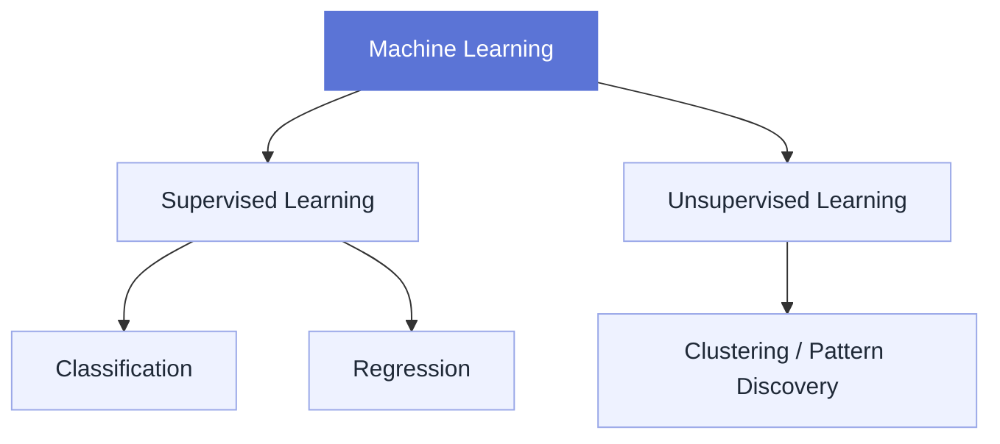
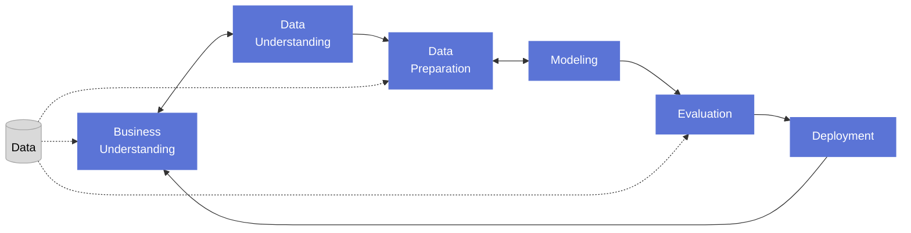

# Introduction to ML

Machine Learning is part of many systems we use every day, often without us noticing it. Examples include recommendation systems, weather forecasting, voice assistants, fraud detection, and applications in healthcare.

Within the broader field of artificial intelligence, Machine Learning focuses on building algorithms that learn patterns from data. Instead of writing explicit rules for every situation, we train a model on examples so that it can make predictions or support decisions on new, unseen data.

A successful Machine Learning project requires more than model training alone. It combines domain knowledge, data analysis, experimentation, and communication with stakeholders. In addition, responsible Machine Learning requires attention to fairness, transparency, privacy, and possible sources of bias.

## Common ML Task Types

Before looking at the project lifecycle, it helps to distinguish between a few common Machine Learning tasks.

- **Classification** predicts a category (e.g. whether an email is spam or not spam).
- **Regression** predicts a numeric value (e.g. the price of a house).
- **Unsupervised Learning** looks for structure in data without labeled targets (e.g. discovering customer segments).

## ML Project Lifecycle

The lifecycle below is iterative rather than strictly linear. In practice, teams often move back and forth between stages as they learn more about the problem, the data, and the model behavior.

1. **Business Understanding**

   Every Machine Learning project starts with a clear problem statement and a shared understanding of the goal. At this stage, you define what success looks like, who the stakeholders are, and which constraints matter, for example interpretability, latency, cost, or legal requirements. A good business understanding helps you decide whether Machine Learning is the right tool for the problem in the first place.

2. **Data Understanding**

   Once the goal is defined, relevant data needs to be collected and explored. The data can take many forms, such as tabular data, images, text, time series, or audio. In this phase, you inspect the structure and quality of the data, identify missing values or unusual patterns, and check whether the available data is actually suitable for solving the problem. This is also the right moment to think about potential bias and data leakage.

3. **Data Preparation**

   Raw data is rarely ready for modeling. It often contains missing values, inconsistencies, duplicates, incorrect formats, or irrelevant features. During data preparation, the data is cleaned, transformed, and sometimes enriched through feature engineering. In many projects, this is also where you split the data into training, validation, and test sets so that model performance can be assessed fairly on unseen data.

4. **Modeling**

   In the modeling phase, Machine Learning algorithms are trained to capture patterns and relationships in the prepared data. The choice of model depends on the problem type, the available data, and the business requirements. A simple baseline model is often a good starting point because it provides a reference point before moving to more complex approaches. In practice, modeling and data preparation are closely connected and often repeated several times.

5. **Evaluation**

   After training, the model's performance and ability to generalize to unseen data must be evaluated. This makes it possible to compare different models and choose the most suitable one for the task. The choice of evaluation metric depends on the problem: classification tasks often use accuracy, precision, recall, or F1 score, while regression tasks commonly use MAE, RMSE, or MAPE. Hyperparameter tuning can improve performance, but it must be done carefully to avoid overfitting. Techniques such as cross-validation and regularization help make evaluation more reliable. The final test set should be used only for the last unbiased assessment, not for repeated tuning.

6. **Deployment**

   Once a model performs well enough for the intended use case, it can be integrated into a production system or application. However, deployment is not the end of the lifecycle. Real-world data can change over time, so deployed models should be monitored for performance degradation, data drift, and unexpected behavior. If necessary, the team returns to earlier stages to collect new data, update features, retrain the model, or refine the business objective.
